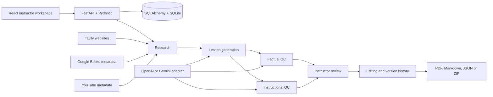

# LessonForge AI

## Project overview and motivation

Preparing a useful lesson takes more than generating text: an instructor must find relevant material, build a teachable sequence, check claims, and decide what is ready for learners. LessonForge AI brings those steps into one local workspace. Given a title and learning objective, it discovers sources, generates a structured lesson with a core time budget of up to 45 minutes, and provides separate factual and instructional reviews. The instructor remains responsible for reviewing the evidence and approving the lesson.

Search results are not proof of factual correctness. Book and video metadata are discovery material; a website excerpt represents only the text retrieved. Missing credentials and provider failures are reported rather than replaced with simulated production content.

## Features

- Dashboard, saved lessons, activity, and visible stage status.
- Real Tavily website research, Google Books discovery, and YouTube Data API v3 discovery, with metadata, references, duplicate removal, and partial-failure reporting.
- Replaceable Gemini/OpenAI structured JSON generation validated by Pydantic.
- Timed sections for overview, objectives, prerequisites, introduction, concepts, examples, applications, activity, knowledge checks, and summary; references and optional supplementary videos.
- Separate factual/research and instructional audit pipelines with issue severity, evidence, limitations, and proposed corrections.
- Review a proposed correction before applying it, reject it, or rerun either audit independently.
- Section editing, Markdown preview, SQLite persistence, version history, restore, and optimistic concurrency protection.
- PDF, Markdown, JSON, separate audit exports, and a combined ZIP package.
- Retry failed stages while retaining completed research, saved content, edits, and previous report data.

## Technology stack and architecture

| Component | Responsibility |
| --- | --- |
| **React 19** | Instructor interface for the dashboard, lesson editor, sources, quality reviews, history, and exports. |
| **Vite** | Frontend development server and production bundler; proxies local API requests. |
| **Tailwind CSS** | CSS tooling alongside the application's custom responsive styles. |
| **FastAPI** | Backend HTTP endpoints, application lifecycle, and workflow requests. |
| **Pydantic** | Validates requests, lesson sections, and structured model output. |
| **SQLAlchemy and SQLite** | Store lessons, versions, and audit history in a local database. |
| **OpenAI / Gemini adapters** | Provide structured model responses for generation and separate QC calls using the configured provider. |
| **Tavily** | Searches for websites and retrieves available text for research. |
| **Google Books** | Discovers book metadata; it does not establish that a full book was read. |
| **YouTube Data API v3** | Discovers video metadata; it does not establish that a video was watched or its transcript reviewed. |



## End-to-end workflow

1. **Research:** Discover websites, books, and videos; retain source information and report partial provider failures.
2. **Lesson generation:** Use the objective and research to produce validated, timed sections, examples, an activity, and knowledge checks.
3. **Factual QC:** Review claims, evidence, citations, contradictions, and potentially misleading content.
4. **Instructional QC:** Separately review objective alignment, clarity, sequencing, examples, activities, assessment, and pacing.
5. **Instructor review:** Inspect the lesson, sources, findings, evidence, and limitations; apply a suitable available proposal or reject a recommendation.
6. **Versioning:** Save edits, review history, and restore a prior content snapshot as a new version. Rerun reviews when they become stale.
7. **Export:** Download the lesson, individual reports, or a combined package.

### Independent quality control

Each QC layer has its own prompt, evaluation responsibilities, and model call. The factual layer receives lesson content and retrieved source excerpts; it flags unsupported or uncertain claims and may associate exact quotations and source IDs with findings. An exact quote match establishes textual presence, not truth or entailment. The instructional layer assesses teaching quality against the objective and does not read the factual report. Findings identify an affected section, severity (**Critical**, **High**, **Medium**, or **Low**), explanation, and recommendation; a safe complete replacement may be available for preview and application. The instructor can reject unsuitable recommendations.

The reviews are **logically independent**: neither consumes the other's report. They may use the same provider and model. This is not independent model training, independent human verification, or proof of correctness.

### Lesson management and reliability

Section edits are saved to SQLite with an expected version. Optimistic concurrency checks reject conflicting saves instead of silently overwriting newer work. Version history preserves content snapshots; restoring one creates a new version rather than erasing history. Content changes mark existing QC reports stale, and each report records the lesson version it assessed. The instructor can rerun either review or both. If a workflow stage fails, its error is shown and it can be retried; completed research and existing lesson edits are protected by the workflow's stage checks.

## Project layout

```text
backend/
  app/
    main.py                 HTTP endpoints and application lifecycle
    config.py               Environment configuration
    database.py, models.py  SQLite storage and saved versions
    schemas.py              Validated request/content contracts
    workflow.py             Staged execution and recovery
    services/
      research_service.py   Website, book, and video discovery
      llm_service.py        Replaceable model adapter
      lesson_generator.py   Structured lesson generation
      qc_research.py        Factual/evidence audit
      qc_instructional.py   Teaching-quality audit
      export_service.py     Downloadable artifacts
  tests/                    Offline tests with explicit provider mocks
frontend/                   React instructor workspace
scripts/live_acceptance.py  Real two-lesson acceptance runner
docs/                       Contract, acceptance checklist, demo script
artifacts/                  Local verification outputs (not API keys)
```

## Prerequisites

- Python 3.11 or newer (Python 3.12 recommended).
- Node.js 22.12 or newer and npm.
- Internet access for provider calls and dependency installation.
- An API key for one LLM provider, a Tavily API key, and a Google Cloud API key with YouTube Data API v3 enabled. A Google Books API key is recommended; unauthenticated Books requests may work but are subject to quota and availability.

## Installation

From the project root, using PowerShell:

```powershell
python -m venv backend/.venv
.\backend\.venv\Scripts\python.exe -m pip install -r backend\requirements.txt
Copy-Item backend\.env.example backend\.env
cd frontend
npm.cmd install
cd ..
```

On macOS/Linux, use `python3 -m venv backend/.venv`, `backend/.venv/bin/python`, `cp`, and `npm` in the equivalent commands.

Edit `backend/.env` locally. **Do not put credentials in frontend files, commit `.env`, or paste keys into a demo recording.**

## Environment variables

`backend/.env.example` is the configuration template. Common settings:

| Variable | Purpose |
| --- | --- |
| `LLM_PROVIDER` | `gemini` or `openai` |
| `GEMINI_API_KEY` | Required when using Gemini |
| `GEMINI_MODEL` | Gemini model identifier supporting structured output |
| `OPENAI_API_KEY` | Required when using OpenAI |
| `OPENAI_MODEL` | OpenAI model identifier supporting structured output |
| `TAVILY_API_KEY` | Website search and retrieved text |
| `GOOGLE_BOOKS_API_KEY` | Optional Google Books key; recommended for reliable quota |
| `YOUTUBE_API_KEY` | YouTube search; enable YouTube Data API v3 in the associated Google Cloud project |
| `DATABASE_URL` | SQLAlchemy SQLite URL; default local database is defined in the template |

Only the selected LLM key is required. Keys are read server-side. Restart the backend after configuration changes. The interface reports whether integrations are configured; configuration alone does not prove that credentials, billing, quota, or model access are valid.

Provider setup references: [Gemini API keys](https://ai.google.dev/gemini-api/docs/api-key), [OpenAI API keys](https://platform.openai.com/api-keys), [Tavily](https://app.tavily.com/), [YouTube API setup](https://developers.google.com/youtube/v3/getting-started), and [Google Books API](https://developers.google.com/books/docs/v1/using).

## Run locally

Open two terminals in the project root.

Backend:

```powershell
.\backend\.venv\Scripts\python.exe -m uvicorn app.main:app --app-dir backend --host 127.0.0.1 --port 8000
```

Frontend:

```powershell
cd frontend
npm.cmd run dev -- --host 127.0.0.1
```

Open the Local URL printed by Vite, normally [http://127.0.0.1:5173](http://127.0.0.1:5173). Vite forwards `/api` requests to the backend. Interactive API documentation is at [http://127.0.0.1:8000/docs](http://127.0.0.1:8000/docs).

Production frontend compilation:

```powershell
cd frontend
npm.cmd run build
```

This is a local, single-instructor application. Public deployment is outside the assignment scope and would require authentication, authorization, production job management, and deployment-specific configuration.

## Using the workspace

Create a lesson with a clear title and objective, then start the workflow. Review the source library and warnings, read the generated lesson, and inspect both QC reports before editing or accepting recommendations. Save or discard local edits before operations that reload the lesson. Use History to inspect or restore saved content, rerun stale reviews, and export the result. Optional supplementary videos are outside the timed core unless the lesson explicitly assigns a timed excerpt.

## API overview

All application routes use the `/api` prefix.

| Method and path | Behavior |
| --- | --- |
| `GET /health` | Service health and nonsecret provider configuration |
| `GET /lessons` | Saved lessons |
| `POST /lessons` | Create a validated draft |
| `GET /lessons/{id}` | Lesson, stages, sources, reports, and activity |
| `PATCH /lessons/{id}` | Save sections using `expected_version` |
| `POST /lessons/{id}/run` | Run/retry a selected stage |
| `GET /lessons/{id}/versions` | Saved content versions |
| `POST /lessons/{id}/restore/{version_id}` | Restore an earlier version as a new revision |
| `POST /lessons/{id}/recommendations/{layer}/{issue_id}` | Apply/reject a recommendation |
| `GET /lessons/{id}/export` | Download PDF, Markdown, JSON, or ZIP |

See [the API contract](docs/API_CONTRACT.md) and the generated `/docs` page for request details. A conflicting version or stale recommendation returns HTTP 409; invalid input returns HTTP 422.

## Testing and reliability

The [verification record](docs/VERIFICATION.md) documents **47 passing backend tests** and a successful **frontend production build** in the recorded workspace. It also records one upstream Starlette deprecation warning. Offline tests use temporary databases and mocked providers; they verify software behavior, not the factual accuracy of generated lessons.


Run the automated backend suite from the root:

```powershell
.\backend\.venv\Scripts\python.exe -m pytest backend\tests -q
```

The workflow tests use temporary SQLite databases and explicitly mocked external providers. They test persistence, failure recovery, independent audit execution, conflict protection, recommendations, versions, and exports. They do **not** demonstrate successful live AI generation or factual correctness of the two assignment lessons.

With the backend running and real credentials configured, run:

```powershell
.\backend\.venv\Scripts\python.exe scripts\live_acceptance.py
```

This uses real APIs, creates both specified lessons, checks the core structure/time/references, saves and reloads an instructor edit, reruns audits, and downloads artifacts under `artifacts/live-acceptance/`. It incurs normal provider usage. Missing required configuration produces a `blocked` result rather than substitute content. Successful technical checks still require the manual factual review in [the acceptance checklist](docs/ACCEPTANCE_CHECKLIST.md).

Helper scripts for live verification (provider scripts use the backend configuration; keep credentials private):

```powershell
# Minimal single structured request to confirm the configured LLM works.
.\backend\.venv\Scripts\python.exe scripts\verify_llm.py --provider openai

# Start the backend, run both live acceptance lessons, then stop the backend.
powershell -ExecutionPolicy Bypass -File scripts\run_acceptance.ps1

# Inspect a saved lesson's section word/minutes/citation profile.
.\backend\.venv\Scripts\python.exe scripts\inspect_lesson.py artifacts\openai-acceptance\http-requests-and-responses.json
```

Use [the verification report](docs/VERIFICATION.md) for the actual checks performed in this workspace, and [the demo script](docs/DEMO_SCRIPT.md) to record the submission.

## Limitations and human oversight

- Generation reliability: the two required lessons were generated live with the OpenAI provider (`gpt-4o-mini`). Because a model can occasionally return section time estimates summing slightly over 45 minutes, quote a non-retrievable source, or repeat a framing section, the pipeline deterministically rebalances the time estimates into the 45-minute budget, reconciles each section's reference list to the sources actually cited/declared, and de-duplicates repeated framing sections before strict Pydantic validation. Content is never discarded for a minor time overrun; genuine citation or structural failures still raise a retryable error that preserves prior work.
- Provider model availability varies by account. Live checks in this workspace passed with OpenAI; Gemini returned intermittent rate-limit (HTTP 429) and model-specific errors during testing. `GEMINI_MODEL`/`OPENAI_MODEL` must name a model that supports structured JSON output and is enabled for the key in use. See the verification report for actual outcomes.

- Live generation and acceptance require valid external API access; offline tests cannot replace the two required real lessons.
- Retrieved text can be incomplete or outdated. Book/video metadata is not the full book or video transcript. The tool does not claim it watched videos or read inaccessible books.
- LLM auditors can miss errors or suggest incorrect changes. A matching quotation establishes textual correspondence, not the truth of the underlying claim. Instructor review is essential.
- Source ranking uses available provider relevance and educational/authoritative indicators; it cannot guarantee source quality.
- Duration is an instructional estimate. Reading speed, discussion, and learner experience vary; preview and time the actual lesson before delivery.
- Background jobs run in the local API process. Keep the server running during work; interrupted jobs need retry after restart.
- SQLite, local storage, and no authentication suit a local demonstration, not a public multi-user service.
- PDF presentation prioritizes readable document output; Markdown is the best editable export for preserving rich lesson structure.

## Acknowledgements

Built with AI coding assistance. The submitter should understand and be able to explain the implementation, prompts, source limitations, QC independence, and tradeoffs. Provider integration behavior follows primary documentation for [Gemini structured output](https://ai.google.dev/gemini-api/docs/structured-output), [OpenAI structured output](https://developers.openai.com/api/docs/guides/structured-outputs), [Tavily search](https://docs.tavily.com/api-reference/endpoint/search), [Google Books volumes](https://developers.google.com/books/docs/v1/reference/volumes/list), and [YouTube search](https://developers.google.com/youtube/v3/docs/search/list). Generated lessons retain their own source references.
